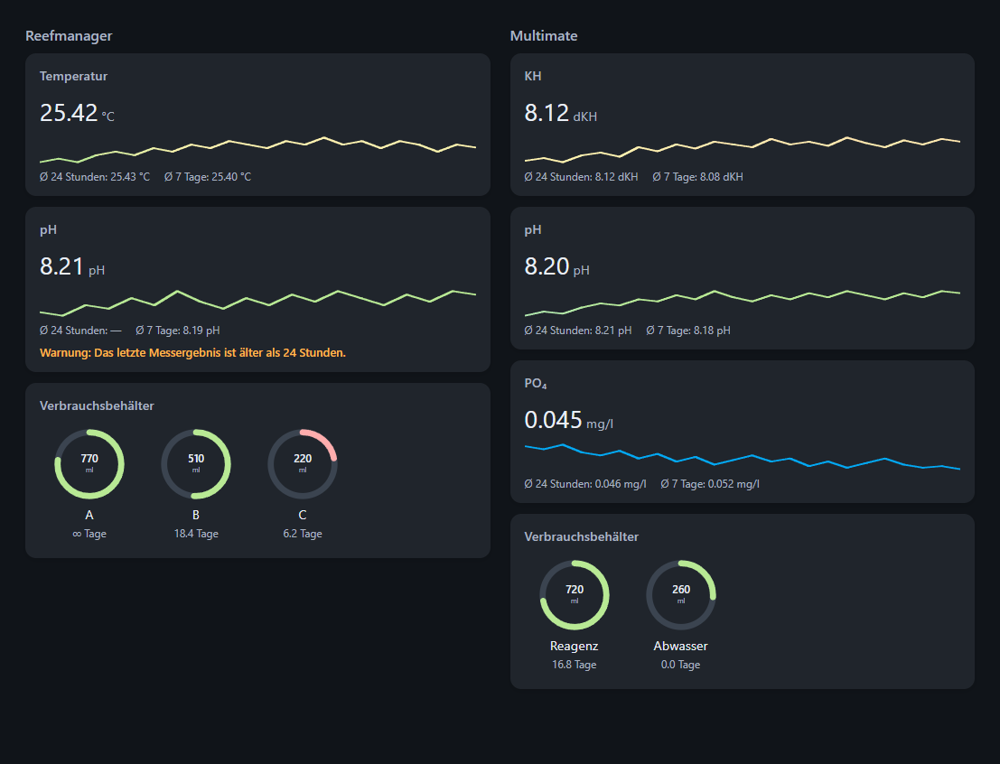

# Reefmanager DIY Card



Ein Custom-Dashboard für Reefmanager und Multimate. Die Karten rufen die Daten direkt über die API der Geräte ab.

## Installation über den Marketplace

1. Öffne den **Marketplace** in Home Assistant.
2. Suche nach **Reefmanager DIY Card** und installiere die Karte.
3. Lade Home Assistant oder den Browser neu, falls erforderlich.
4. Füge im Dashboard **Reefmanager DIY Card** oder **Multimate DIY Card** hinzu und konfiguriere die IP-Adresse des Geräts.

## Reefmanager-Karte

Die Reefmanager-Karte zeigt gemessene Temperaturwerte nur dann an, wenn sie größer als 0 sind. Der pH-Wert aus `/api/ph/live` wird nur bei `success: true` und einem Wert größer als 0 angezeigt. Temperaturverlauf und Durchschnittstemperatur der letzten 24 Stunden und sieben Tage kommen aus `/api/temperature/history.bin`; pH-Verlauf und Durchschnittswerte aus `/api/ph/history.bin`. Ungültige und nullwertige Messungen werden ignoriert. Beide Verläufe sind standardmäßig auf die letzten sieben Tage begrenzt. Ist der letzte Verlaufsmesspunkt einer Messgröße älter als 24 Stunden, zeigt die zugehörige Kachel eine Warnung an. Ein Klick auf eine Verlaufskurve öffnet ein detailliertes Diagramm mit Zeit- und Messwertachse; beim Überfahren eines Messpunkts mit der Maus werden Zeitpunkt und Messwert eingeblendet. Der Titel „Reefmanager“ verlinkt auf die Weboberfläche des Geräts; die Verbrauchsbehälter-Kachel öffnet `/containers.html`.

Standard-IP-Adresse: `192.168.178.91`

```yaml
type: custom:reefmanager-diy-card
host: 192.168.178.91
refresh_interval: 30
history_days: 7
```

Die Verlaufskurve verwendet standardmäßig diese Temperatur-Farbpunkte. Zwischen den Farben wird weich interpoliert. Die Farbwerte sind im visuellen Editor in der einklappbaren Gruppe **Temperatur-Farbverlauf** konfigurierbar:

| Temperatur | Farbe |
|---:|:---|
| 23 °C | `#A2D2FF` |
| 24,5 °C | `#A8E6CF` |
| 25 °C | `#B8E994` |
| 25,5 °C | `#FFF3B0` |
| 27 °C | `#FFADAD` |

Temperaturwerte müssen aufsteigend sortiert sein; Farben müssen im Format `#RRGGBB` angegeben werden. Die YAML-Optionen heißen `temperature_gradient_1_value` bis `temperature_gradient_5_value` und `temperature_gradient_1_color` bis `temperature_gradient_5_color`.

```yaml
type: custom:reefmanager-diy-card
temperature_gradient_1_value: 23
temperature_gradient_1_color: "#A2D2FF"
temperature_gradient_2_value: 24.5
temperature_gradient_2_color: "#A8E6CF"
temperature_gradient_3_value: 25
temperature_gradient_3_color: "#B8E994"
temperature_gradient_4_value: 25.5
temperature_gradient_4_color: "#FFF3B0"
temperature_gradient_5_value: 27
temperature_gradient_5_color: "#FFADAD"
```

Die Füllstandsringe der Dosierbehälter zeigen den aktuellen Inhalt und färben sich abhängig vom Füllstand: ab 50 % grün (`#B8E994`), unter 50 % gelb (`#FFF3B0`) und unter 25 % rot (`#FFADAD`).

## Multimate-Karte

Die Multimate-Karte verwendet denselben Kachelstil wie die Reefmanager-Karte. Sie zeigt KH und PO₄ nur bei Messwerten größer als 0. Der pH-Wert aus `/api/kh/status` wird nur angezeigt, wenn zusätzlich `ph_enabled: true` ist. KH- und pH-Verläufe kommen aus `/api/kh/history`: Punkte mit `v` liefern KH, Punkte mit `p` pH. Der PO₄-Verlauf kommt aus `/api/po4/history` als Punkte mit `t` (Zeit) und `po4` (Messwert); ein zusätzliches Feld `p` wird dafür nicht verwendet. Werte von 0 oder kleiner werden ignoriert; für alle drei Messgrößen zeigt die Karte Durchschnitte der letzten 24 Stunden und sieben Tage. Ist der letzte Verlaufsmesspunkt einer Messgröße älter als 24 Stunden, zeigt die zugehörige Kachel eine Warnung an. Ein Klick auf eine Verlaufskurve öffnet ein detailliertes Diagramm mit Zeit- und Messwertachse; beim Überfahren eines Messpunkts mit der Maus werden Zeitpunkt und Messwert eingeblendet. Reagenz- und Abwasserstand werden als Füllstandsringe aus `/api/containers` angezeigt. Auf schmalen Smartphone-Bildschirmen werden bis zu vier Behälter nebeneinander angeordnet. Der Titel „Multimate“ verlinkt auf die Weboberfläche des Geräts; die Verbrauchsbehälter-Kachel öffnet `/containers.html`. Die KH-Kurve interpoliert weich zwischen diesen Farbwerten:

| KH-Wert | Farbe |
|---:|:---|
| 6,5 | `#A2D2FF` |
| 7 | `#A8E6CF` |
| 7,5 | `#B8E994` |
| 8 | `#FFF3B0` |
| 8,5 | `#FFADAD` |

Der Reagenzring verwendet dieselbe Farbskala wie beim Reefmanager: ab 50 % grün, unter 50 % gelb und unter 25 % rot. Beim Abwasserbehälter bedeutet ein steigender Füllstand ein steigendes Risiko: bis einschließlich 50 % grün, über 50 % bis unter 75 % gelb und ab 75 % rot.

Die KH-Farbpunkte sind im visuellen Editor in der einklappbaren Gruppe **KH-Farbverlauf** einstellbar. Die fünf Werte müssen aufsteigend sortiert sein; Farben müssen im Format `#RRGGBB` angegeben werden. Per YAML heißen die Optionen `kh_gradient_1_value` bis `kh_gradient_5_value` und `kh_gradient_1_color` bis `kh_gradient_5_color`:

```yaml
type: custom:multimate-diy-card
kh_gradient_1_value: 6.5
kh_gradient_1_color: "#A2D2FF"
kh_gradient_2_value: 7
kh_gradient_2_color: "#A8E6CF"
kh_gradient_3_value: 7.5
kh_gradient_3_color: "#B8E994"
kh_gradient_4_value: 8
kh_gradient_4_color: "#FFF3B0"
kh_gradient_5_value: 8.5
kh_gradient_5_color: "#FFADAD"
```

Der pH-Farbverlauf ist bei beiden Karten im visuellen Editor in der einklappbaren Gruppe **pH-Farbverlauf** einstellbar. Die fünf Werte müssen aufsteigend sortiert sein; Farben müssen im Format `#RRGGBB` angegeben werden. Per YAML heißen die Optionen `ph_gradient_1_value` bis `ph_gradient_5_value` und `ph_gradient_1_color` bis `ph_gradient_5_color`:

```yaml
type: custom:multimate-diy-card
ph_gradient_1_value: 7.8
ph_gradient_1_color: "#A2D2FF"
ph_gradient_2_value: 8
ph_gradient_2_color: "#A8E6CF"
ph_gradient_3_value: 8.2
ph_gradient_3_color: "#B8E994"
ph_gradient_4_value: 8.4
ph_gradient_4_color: "#FFF3B0"
ph_gradient_5_value: 8.6
ph_gradient_5_color: "#FFADAD"
```

Standard-IP-Adresse: `192.168.178.92`

```yaml
type: custom:multimate-diy-card
host: 192.168.178.92
refresh_interval: 30
history_days: 7
```

## Konfiguration

Beide Karten unterstützen den visuellen Editor und YAML. Dort kannst du die IP-Adresse, den Kartentitel und das Aktualisierungsintervall festlegen. Bei beiden Karten ist die Anzahl der angezeigten Verlaufstage sowie der pH-Farbverlauf einstellbar; zusätzlich lassen sich beim Reefmanager die Temperatur-Farbpunkte und bei Multimate der KH-Farbverlauf anpassen. Die Farbverläufe sind im visuellen Editor einklappbar gruppiert. Mit `refresh_interval: 0` werden die Werte einmal beim Öffnen der Karte geladen und danach nicht automatisch aktualisiert. Der Klick auf eine Verlaufsdiagramm-Kurve öffnet eine vergrößerte Ansicht mit Zeit- und Messwertachse.

| Option | Karten | Standard | Werte |
|---|---|---:|---|
| `host` | Reefmanager, Multimate | gerätespezifische Standard-IP | IP-Adresse ohne `http://` |
| `title` | Reefmanager, Multimate | `Reefmanager` oder `Multimate` | Freitext |
| `refresh_interval` | Reefmanager, Multimate | `30` Sekunden | `0` = nur einmal beim Öffnen; sonst 5–3600 Sekunden |
| `history_days` | Reefmanager, Multimate | `7` Tage | 1–7 Tage; begrenzt alle angezeigten Verläufe |
| `temperature_gradient_1_value` bis `temperature_gradient_5_value` | Reefmanager | siehe Farbskala oben | aufsteigende Temperaturwerte in °C |
| `temperature_gradient_1_color` bis `temperature_gradient_5_color` | Reefmanager | siehe Farbskala oben | Farben im Format `#RRGGBB` |
| `kh_gradient_1_value` bis `kh_gradient_5_value` | Multimate | siehe KH-Farbskala oben | aufsteigende KH-Werte von 0 bis 20 dKH |
| `kh_gradient_1_color` bis `kh_gradient_5_color` | Multimate | siehe KH-Farbskala oben | Farben im Format `#RRGGBB` |
| `ph_gradient_1_value` bis `ph_gradient_5_value` | Reefmanager, Multimate | 7,8; 8,0; 8,2; 8,4; 8,6 | aufsteigende pH-Werte von 0 bis 14 |
| `ph_gradient_1_color` bis `ph_gradient_5_color` | Reefmanager, Multimate | siehe Standard-pH-Farbskala oben | Farben im Format `#RRGGBB` |

Die Karte ergänzt `http://` automatisch. Der Browser, in dem Home Assistant läuft, muss die Geräte-IP erreichen können. Die Geräte-API muss außerdem Anfragen von Home Assistant erlauben (CORS). Bei einem per HTTPS aufgerufenen Home Assistant kann der Browser HTTP-Anfragen an die Geräte als Mixed Content blockieren.
